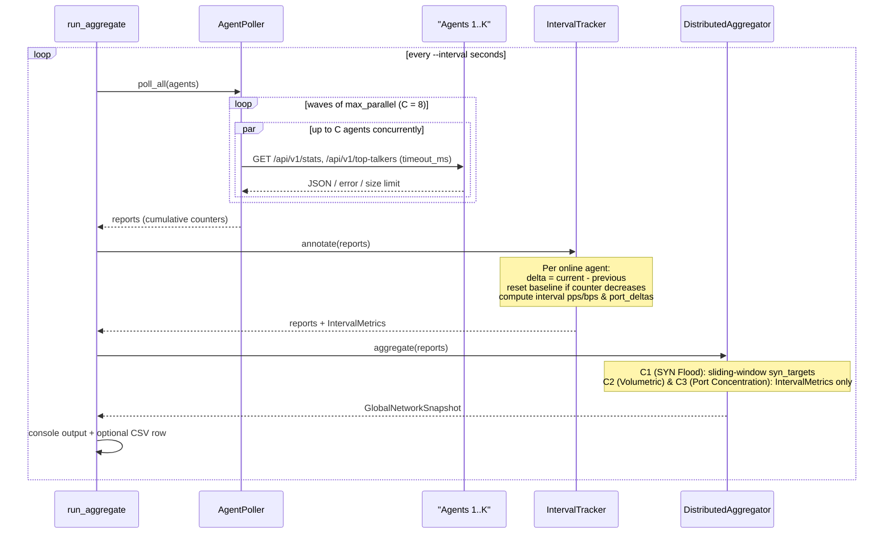

# NetSight

<p align="center">
  A C++17-based, lightweight and multi-threaded network packet analyzer and distributed anomaly detector.
</p>

<p align="center">
  Every release generates a set of tests.Tests are made for each release.
  
  
  
  <a href="./LICENSE"></a>
</p>

---

## Overview

NetSight is a cross-platform network telemetry agent & distributed DDoS aggregator that has been implemented in modern (C++17) c++. It works in two parallel ways:

Live traffic capturing from OS interfaces (libpcap / Npcap), offline .pcap replay, reading of Link/Network/Transport headers without any undefined behaviors, running a sliding window anomaly detector (SYN flood / port scan) and exporting of time-series/summary .csv files, and a real-time metrics service provided by an embedded http rest service.
2. Distributed Correlation Aggregator (`aggregate`): Collects the data sent from multiple NetSight agents in a bounded parallel waves and calculates the per-round interval deltas (`IntervalTracker`), and correlate attacks from multiple vantage points (`DistributedSynFlood`, DistributedVolumetricFlood` and DistributedTargetConcentration`).

### Key Capabilities

UB-Free Byte-Level Parsing: Parses Ethernet (including up to 2 stacked VLAN tags 0x8100/0x88A8/0x9100), BSD Null/Loopback, and Linux SLL link layers, IPv4, IPv6, ARP network layers, and TCP, UDP, ICMP, and ICMPv6 transport protocols without endian-dependency or `reinterpret_cast`, but with bounds-checked `ByteReader` operations.
Bounded Backpressure Pipeline: provides a way to transport packets from the capture thread to the analytics worker with the help of a `BoundedQueue` to prevent the memory queue from growing when capturing at a high rate in the midst of a large packet flood (can be lossless and used for off-line analysis of a .pcap).
* **Single-Node Sliding-Window Detectors:**
  SynFloodDetector: Continues to track the SYN and SYN-ACK for each (dst_ip, dst_port) endpoint, and implements hysteresis recovery, while having limited target/alert tables.
  PortScanDetector: Keeps a window of memory of limited size for each source IP, in which to look for a set of destination ports.
* **Interval-Based Distributed Correlation:**
  The agents are asked of in waves of up to `--max-parallel=` (default 8) requests; with a timeout per request in milliseconds (`--timeout-ms`) and a timeout on the agents' response body sizes (a default of 1 MiB).
  For each agent, it computes deltas per round for the `packets`, `wire_bytes`, `tcp`, `udp`, `icmp` + `icmpv6`, `other`, `pps`, `bps` packet counters and for each port, it computes the `port_deltas`. These deltas are calculated without any requirement to gap fill or deal with counter resets.
  `DistributedAggregator` is a stateless function against enriched `AgentMetricsReport` values that provides a global result.
Clean Layering: `netsight_core` is completely independent of OS capture drivers (libpcap/Npcap), keeping native capture bindings in `netsight_capture` and orchestration of this in the CLI and runtime in `netsight_app.

---

## Architecture

### Module Layering

```text
+-------------------------------------------------------------------+
|                        netsight (CLI App)                         |
|            apps/netsight: Cli, App, Signals, main                 |
+---------------------------------+---------------------------------+
                                  |
                                  v
+-------------------------------------------------------------------+
|                        netsight_capture                           |
|       Native OS capture (libpcap / Npcap with MSVC delay-load)    |
+---------------------------------+---------------------------------+
                                  |
                                  v
+-------------------------------------------------------------------+
|                          netsight_core                            |
|  core/       ByteReader, IpAddress, Time, RawPacket               |
|  source/     IPacketSource, PcapFileReader, ThreadedPacketSource  |
|  parser/     PacketParser, ParsedPacket                           |
|  concurrency/ BoundedQueue (DropNewest / Block)                   |
|  pipeline/   CaptureSession, PacketFilter                         |
|  analytics/  TrafficAnalyzer, StatsAggregator, SynFloodDetector,  |
|              PortScanDetector, IntervalTracker,                   |
|              DistributedAggregator                                |
|  export/     JsonSerializer, RestServer, AgentPoller, CsvWriter   |
+-------------------------------------------------------------------+
```

This command is used for Distributed Aggregation Round.This command is for Distributed Aggregation Round.

Every polling round performs a bounded parallel wave of HTTP GET requests, transforms count-based agents to deltas per polling round and applies attack criteria distributed over the rounds:



---

## Prerequisites & Building

### Prerequisites

* **C++ Compiler:** GCC 9+, Clang 10+, or MSVC 2019+ (C++17 required)
* **Build System:** CMake 3.20+
* **Packet Capture Library:**
  ```sudo apt install libpcap-dev on Linux.
  To use the script, install Npcap SDK and set the -DNPCAP_SDK_DIR environment variable to point to the SDK directory (which is found at C:/npcap-sdk by default):

CMake also automatically downloads third-party libraries including GoogleTest v1.15.2, nlohmann/json v3.11.3, cpp-httplib v0.18.5 and CLI11 v2.6.2 by using FetchContent.

### Building from Source

```bash
# 1. Clone the repository
git clone https://github.com/BohdanShkill/NetSight.git
cd NetSight

# 2. Configure (out-of-source build)
cmake -S . -B build -DCMAKE_BUILD_TYPE=Debug
# Windows with custom Npcap SDK path:
# cmake -S . -B build -DCMAKE_BUILD_TYPE=Debug -DNPCAP_SDK_DIR="C:/npcap-sdk"

# 3. Compile all libraries, CLI binary, and tests
cmake --build build --config Debug
```

### Live Packet Capture Permissions

On Linux: use the sudo command or set the CAP_NET_RAW capability on the binary:
  ```bash
  sudo setcap cap_net_raw,cap_net_admin=eip ./build/apps/netsight/netsight
  ```
For Windows: Install the [Npcap](https://npcap.com/) runtime driver. If Npcap is installed with a "Restrict driver access to Administrators only" restriction, use elevated terminal to execute live captures. Without installing Npcap (MSVC: `/DELAYLOAD:wpcap.dll`), offline analysis of a PCAP file and distributed `aggregate` mode is possible.

### Running Tests

All unit/lifecycle tests are controlled through CTest and executed without root privileges or OS capture drivers:

```bash
ctest --test-dir build --output-on-failure -C Debug
```

To add privileged live-capture integration tests for Linux:

```bash
sudo env NETSIGHT_REQUIRE_LIVE=1 ctest --test-dir build -C Debug -L integration --output-on-failure
```

---

## CLI Reference

Run time errors will result in an exit code of 1 (`usage / argument validation error`), and if one or more agents does not respond to the call, the exit code will be 1 (capture/IO error).

### `netsight list`

Lists the available OS network capture interfaces and their index and description.

```bash
./build/apps/netsight/netsight list
```

### `netsight capture`

Replays live traffic from an interface, or offline traffic from a .pcap file.

| Option | Default | Description |
| :--- | :--- | :--- |
| `-i, --interface <name\|idx>` | — | Live capture interface name or index (mutually exclusive with `-r`) |
| `-r, --read-file <path>` | — | Path to offline `.pcap` file (mutually exclusive with `-i`) |
| `--bpf <expr>` | `""` | BPF filter expression (live capture only; excludes `-r`) |
| `--snaplen <bytes>` | `65535` | Capture snapshot length (`64..262144`; excludes `-r`) |
| `--no-promisc` | `false` | Disable promiscuous mode (excludes `-r`) |
| `--filter-ip <ip>` | — | Filter parsed packets matching source or destination IPv4/IPv6 |
| `--filter-port <port>` | — | Filter parsed packets matching source or destination L4 port (`1..65535`) |
| `--duration <sec>` | — | Auto-stop capture after `N` seconds (`> 0.0`) |
| `--count <packets>` | — | Auto-stop capture after `N` accepted packets (`>= 1`) |
| `--queue-size <cap>` | `8192` | Internal bounded packet queue capacity (`1..1048576`) |
| `--csv <prefix>` | — | Write `<prefix>_timeseries.csv` and `<prefix>_summary.csv` |
| `--api-port <port>` | — | Enable embedded REST API server on port (`0..65535`, `0` = ephemeral) |
| `--api-host <host>` | `127.0.0.1` | Bind host/IP for REST API (requires `--api-port`) |
| `--api-token <token>` | `""` | Bearer token for REST API endpoints except `/api/v1/health` (requires `--api-port`) |
| `-q, --quiet` | `false` | Suppress periodic TTY status and final summary |

**Examples:**

```bash
# Offline .pcap analysis with CSV export
./build/apps/netsight/netsight capture -r tests/data/lo_tcp.pcap --csv out/session

# Run as a live telemetry agent exposing an authenticated REST API
./build/apps/netsight/netsight capture -i eth0 --bpf "ip or ip6" --api-port 8081 --api-token secret123
```

### `netsight aggregate`

Multiples NetSight agents and identifies distributed attacks from vantage points.

| Option | Default | Description |
| :--- | :--- | :--- |
`-a, --agent <host:port>` | *(required)* | Agent endpoint (`host:port`, optional `http://`/`https://` prefix); can be repeated |
| `--api-token <token>` | `""` | Bearer token sent to all agents |
| `--interval <sec>` | `1.0` | Polling interval in seconds (`> 0.0`) |
| `--timeout-ms <ms>` | `1000` | Per-request HTTP connect/read timeout in ms (`50..60000`) |
| `--rounds <n>` | `0` | Number of polling rounds (`0` = run until `SIGINT`/`SIGTERM`) |
Minimum number of witness agents needed for a distributed alert (>= 1) | `--min-agents <k> 2`
| `--syn-threshold <pps>` | `100.0` | Global distributed SYN flood rate threshold in SYN/s (`> 0.0`) |
| `--pps-threshold <pps>` | `500.0` | Global volumetric flood threshold in packets/s (`> 0.0`) |
| `--syn-ack-ratio <ratio>` | `0.25` | Maximum `SYN-ACK / SYN` ratio for SYN flood detection (`(0.0, 1.0]`) |
| `--proto-share <share>` | `0.70` | Minimum dominant protocol share (`UDP` or `ICMP`-family) (`(0.0, 1.0]`) |
| `--port-share <share>` | `0.60` | Minimum destination port share for target concentration (`(0.0, 1.0]`) |
`--csv <path>` | — | Output per-round global metrics to a file of path name |
`-q, --quiet` | `false` | Suppress frequency of console output and summary at end of processing |

> [!NOTE]
> At worst, the polling round lasts a total of $\lceil K / C \rceil \cdot 2$ times $t_{\text{timeout}}$ (where $C = 8$ is the number of agents per polling round, and each agent gets two sequential requests: one for /api/v1/stats and the other for /api/v1/top-talkers). If this bound is greater than the value of the option `--interval`, `aggregate` prints a startup warning to the terminal `stderr` and proceeds anyway.

**Example:**

```bash
./build/apps/netsight/netsight aggregate \
  --agent 127.0.0.1:8081 \
  --agent 127.0.0.1:8082 \
  --agent 127.0.0.1:8083 \
  --interval 1.0 \
  --timeout-ms 500 \
  --min-agents 2 \
  --syn-threshold 100 \
  --syn-ack-ratio 0.25 \
  --pps-threshold 500 \
  --proto-share 0.70 \
  --port-share 0.60 \
  --csv out/distributed_rounds.csv
```

---

## REST API Reference

When using the command-line argument `--api-port` with the `capture` mode, NetSight provides read-only JSON endpoints (only `GET`, no other HTTP method will return anything other than a `405 Method Not Allowed`). When `--api-token` is set, all endpoints (except for `/api/v1/health`) must include the following header: `Authorization: Bearer <token>`.

| Endpoint | Query Parameters | Description |
| :--- | :--- | :--- |
`GET /api/v1/health` | — | Health, version and current `snapshot_seq` (always public) |
The following are returned as part of the cumulative totals, parse counts, L3/L4 breakdown, `top_ports`, `syn_targets`, and `active_alerts` count: |
List of top ranked source/talker IPs based on bytes/packets.List of top-talkers by source/talker ip by using ‘limit’ parameter (1 up to 1000).
| `GET /api/v1/alerts` | `state` (`all`\|`active`\|`resolved`), `limit` (`1..1000`) | Single-node `syn_flood` and `port_scan` alerts |
— | Packet filter, bounded queue, kernel/interface, and untracked table drop counters.

---

## CSV Output Formats

### Agent Capture (`--csv <prefix>`)

`<prefix>_timeseries.csv`: 1-second bucketed deltas: ` interval_start,packets,bytes,tcp_packets,udp_packets,icmp_packets,other_packets,parse_errors,dropped,active_alerts`.
`<prefix>_summary.csv`: Key-value session report (section,item,metric,value), includes metadata, totals, parse statuses, L3/L4 protocol breakdown, protocol drops, top talkers, top ports and alerts.

Distributed Aggregator, named --csv <path> stores the resultset in the specified path as a comma delimited file.

Rows per round, both cumulative and interval (as bytes/s: `global_pps`, `global_bps`, as packets: `interval_packets`, as agents: `interval_agents`)

```csv
round,online_agents,total_agents,total_packets,total_wire_bytes,global_pps,global_bps,tcp_packets,udp_packets,icmp_packets,other_packets,active_alerts,interval_packets,interval_agents
```

---

## Assumptions & Known Limitations

Distributed correlation: Non-overlapping vantage points for agents. If the same network flow passes through multiple agents, the packets, byte rates, SYN target rates per network flow are added on a per-reporting-agent basis (which is documented and covered by characterization tests).
Each agent has its own sliding window `syn_targets` based on the local packet timestamps. Aggregated SYN flood metrics are taken across snapshots polled in the same round without necessarily relying on cross-agent timestamp alignment and clock synchronization.
first-observation baseline equals zero: When creating a new agent, the baseline will be zero, and the first interval that is observed will be the agent's cumulative history since the start of the program. This maintains the backwards compatibility of single-round (--rounds 1) runs and offline playback.
Static packet-time clock on idle agents: The interval rates (e.g., pps, bps) are calculated based on (packet) timestamps and not wall-clock time. If no new packets are received in an interval while `duration_seconds` does not advance (`dt == 0` and `d_packets == 0`), then the interval is marked valid, but does not contribute to interval criteria.If no new packets are received in an interval while `duration_seconds` does not advance (`dt == 0` and `d_packets == 0`), then the interval is marked valid, but does not contribute to interval criteria.
By default, each agent exposes the following top-level settings: `syn_targets`: up to 16, `top_ports`: up to 10, and `AgentPoller` / `JsonSerializer`: up to 256 elements per array of parsed JSON. `IntervalTracker` keeps up to 64 ports per agent. A port is skipped once in the first k rounds it is added to the agent's top-K list, since its pre-entry baseline is not known.

---

## License

This project is open-source software licensed under the [MIT License](LICENSE).
