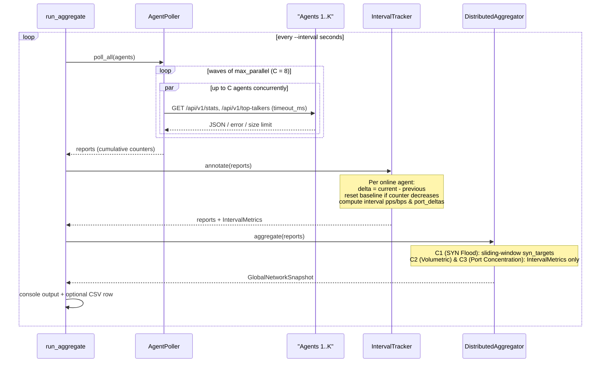

# NetSight

<p align="center">
  Lightweight Multi-threaded network packet analyzer and distributed Anomaly detector written in C++17.
</p>

<p align="center">
  
  
  
  <a href="./LICENSE"></a>
</p>

---

## Overview

NetSight is a modern C++17 cross-platform network telemetry agent and distributed DDoS aggregator. It is available in two modes:

1. Telemetry Agent (`capture`) - Captures live traffic from OS interfaces (libpcap / Npcap) and replays offline .pcap files, parses Link/Network/Transport headers - No UAE (Undefined behavior errors), exports time-series and summary .csv files, real-time metrics through embedded REST API.
Distributed Correlation Aggregator (`aggregate`): polls many NetSight agents in bounded parallel waves, calculates the total counter and converts it to a delta per round (IntervalTracker), and correlates attacks observed from different vantage points (DistributedSynFlood, DistributedVolumetricFlood, DistributedTargetConcentration).

### Key Capabilities

Ethernet (up to 2 stacked VLAN tags: 0x8100 / 0x88A8 / 0x9100), BSD Null/Loopback and Linux SLL link layers, IPv4, IPv6 and ARP network layers, TCP, UDP, ICMP and ICMPv6 transport protocols. There is no endianness assumptions, no reinterpret_cast and all reads are bound checked in the ByteReader.
The bounded backpressure pipeline is the name of the pipeline, due to a high-rate flood in the pipe from the capture thread to the analytics worker, the pipeline keeps memory bounded. It may also be used in lossless mode (blocking mode) for analysis of an offline `.pcap` file.
* **Single-Node Sliding-Window Detectors:**
  It is also covered by the `SynFloodDetector`, which visualizes the number of SYN and SYN-ACK received at a `(dst_ip, dst_port)` endpoint, and activates the recovery with the help of the hysterisis and limits the size of the `target_table` and the `alert_table`.
  Per source-IP a window of interesting destination ports, limited by `PortScanDetector`, is kept.
* **Interval-Based Distributed Correlation:**
  We send our agents in waves of 8 simultaneous requests per request; we use the wave timeout (`--timeout-ms`) and the max body size of returned responses (1 MiB).
  For each agent, `IntervalTracker` calculates per-round deltas for packets, wire_bytes, tcp, udp, icmp (+ icmpv6) and other, interval pps / bps and per-port port_deltas. There will be no agents that reset (counter reset) and no missed rounds.
  The `AgentMetricsReport` values are passed to a stateless function, named `DistributedAggregator`, for each value in this list, and are aggregated into a single `GlobalNetworkSnapshot` value.Each of these values in the list are passed to a stateless function named DistributedAggregator, where they are aggregated into a single GlobalNetworkSnapshot value.
Clean Layering: The `netsight_core` does not rely on the OS capture drivers. The native capture bindings are now in netsight_capture and the parsing and runtime orchestration of capture commandline is in the netsight app.

---

## Architecture

### Module Layering

```text
+-------------------------------------------------------------------+
|                        netsight (CLI App)                         |
|            apps/netsight: Cli, App, Signals, main                 |
+---------------------------------+---------------------------------+
                                  |
                                  v
+-------------------------------------------------------------------+
|                        netsight_capture                           |
|       Native OS capture (libpcap / Npcap with MSVC delay-load)    |
+---------------------------------+---------------------------------+
                                  |
                                  v
+-------------------------------------------------------------------+
|                          netsight_core                            |
|  core/       ByteReader, IpAddress, Time, RawPacket               |
|  source/     IPacketSource, PcapFileReader, ThreadedPacketSource  |
|  parser/     PacketParser, ParsedPacket                           |
|  concurrency/ BoundedQueue (DropNewest / Block)                   |
|  pipeline/   CaptureSession, PacketFilter                         |
|  analytics/  TrafficAnalyzer, StatsAggregator, SynFloodDetector,  |
|              PortScanDetector, IntervalTracker,                   |
|              DistributedAggregator                                |
|  export/     JsonSerializer, RestServer, AgentPoller, CsvWriter   |
+-------------------------------------------------------------------+
```

### Distributed Aggregation Round

The polling rounds send out HTTP GET requests in waves and calculate the deltas of each round as the difference between the agent counters that returned from each round and the total count of the previous polling round, which is then applied to the distributed attack criteria:



---

## Prerequisites & Building

### Prerequisites

* **C++ Compiler:** GCC 9+, Clang 10+, or MSVC 2019+ (C++17 required)
* **Build System:** CMake 3.20+
* **Packet Capture Library:**
  On Linux: Install `libpcap-dev` using apt: `apt install libpcap-dev`
  For Windows: Set this parameter to Npcap SDK directory (default `C:/npcap-sdk`) and install Npcap SDK.

GoogleTest v1.15.2, nlohmann/json v3.11.3, cpp-httplib v0.18.5 and CLI11 v2.6.2 are automatically downloaded by CMake's FetchContent.

### Building from Source

```bash
# 1. Clone the repository
git clone https://github.com/BohdanShkill/NetSight.git
cd NetSight

# 2. Configure (out-of-source build)
cmake -S . -B build -DCMAKE_BUILD_TYPE=Debug
# Windows with custom Npcap SDK path:
# cmake -S . -B build -DCMAKE_BUILD_TYPE=Debug -DNPCAP_SDK_DIR="C:/npcap-sdk"

# 3. Compile all libraries, CLI binary, and tests
cmake --build build --config Debug
```

### Live Packet Capture Permissions

For Linux: use the `sudo` prefix or give the binary these capabilities: `sudo setcap -c cap_net_raw,cap_net_admin,cap_net_bind+ep ./raw-socket`

  ```bash
  sudo setcap cap_net_raw,cap_net_admin=eip ./build/apps/netsight/netsight
  ```

For Windows: Use [Npcap](https://npcap.com/) as a runtime driver. To get live captures without limitation, even if Npcap was installed with the option Restrict driver access to Administrators only, you would need to access Npcap's terminal from an elevated terminal. The ability for offline analysis of `.pcap` files, as well as the possibility to use an aggregate mode (which saves time slowing down the computer during analysis), are possible even if Npcap is not installed thanks to the delay loading of MSVC (`/DELAYLOAD:wpcap.dll`).

### Running Tests

All unit and lifecycle tests run through CTest and need neither root privileges nor OS capture drivers:

```bash
ctest --test-dir build --output-on-failure -C Debug
```

To also run the privileged live-capture integration tests on Linux:

```bash
sudo env NETSIGHT_REQUIRE_LIVE=1 ctest --test-dir build -C Debug -L integration --output-on-failure
```

---

## CLI Reference

| Exit code | Meaning |
| :---: | :--- |
| `0` | Success |
Run-time error `1` (capture/IO failure or all agents unreachable over all rounds in `aggregate`) | Run-time error |
The use of, or mis-use of, arguments causes an error, message: `2` | Usage / argument validation error |

### `netsight list`

Prints list of available OS capture interfaces and their description and index.

```bash
./build/apps/netsight/netsight list
```

### `netsight capture`

Streams and replays live network traffic or an offline `.pcap` file.

| Option | Default | Description |
| :--- | :--- | :--- |
| `-i, --interface <name\|idx>` | — | Live capture interface name or index (mutually exclusive with `-r`) |
| `-r, --read-file <path>` | — | Path to offline `.pcap` file (mutually exclusive with `-i`) |
| `--bpf <expr>` | `""` | BPF filter expression (live capture only; excludes `-r`) |
| `--snaplen <bytes>` | `65535` | Capture snapshot length (`64..262144`; excludes `-r`) |
| `--no-promisc` | `false` | Disable promiscuous mode (excludes `-r`) |
| `--filter-ip <ip>` | — | Keep only parsed packets whose source or destination matches this IPv4/IPv6 address |
| `--filter-port <port>` | — | Keep only parsed packets whose source or destination L4 port matches (`1..65535`) |
| `--duration <sec>` | — | Auto-stop capture after `N` seconds (`> 0.0`) |
| `--count <packets>` | — | Auto-stop capture after `N` accepted packets (`>= 1`) |
| `--queue-size <cap>` | `8192` | Internal bounded packet queue capacity (`1..1048576`) |
| `--csv <prefix>` | — | Write `<prefix>_timeseries.csv` and `<prefix>_summary.csv` |
| `--api-port <port>` | — | Enable embedded REST API server on port (`0..65535`, `0` = ephemeral) |
| `--api-host <host>` | `127.0.0.1` | Bind host/IP for REST API (requires `--api-port`) |
| `--api-token <token>` | `""` | Bearer token for REST API endpoints except `/api/v1/health` (requires `--api-port`) |
| `-q, --quiet` | `false` | Suppress periodic TTY status and final summary |

**Examples:**

```bash
# Offline .pcap analysis with CSV export
./build/apps/netsight/netsight capture -r tests/data/lo_tcp.pcap --csv out/session

# Run as a live telemetry agent exposing an authenticated REST API
./build/apps/netsight/netsight capture -i eth0 --bpf "ip or ip6" --api-port 8081 --api-token secret123
```

### `netsight aggregate`

If you have multiple Vantage agents on multiple NetSight servers, you can use a poll to detect distributed attacks.

| Option | Default | Description |
| :--- | :--- | :--- |
| `-a, --agent <host:port>` | *(required)* | Agent endpoint (`host:port`, optional `http://` / `https://` prefix); can be repeated |
| `--api-token <token>` | `""` | Bearer token sent to all agents |
| `--interval <sec>` | `1.0` | Polling interval in seconds (`> 0.0`) |
| `--timeout-ms <ms>` | `1000` | Per-request HTTP connect/read timeout in ms (`50..60000`) |
| `--rounds <n>` | `0` | Number of polling rounds (`0` = run until `SIGINT` / `SIGTERM`) |
| `--min-agents <k>` | `2` | Minimum number of witness agents required for a distributed alert (`>= 1`) |
| `--syn-threshold <pps>` | `100.0` | Global distributed SYN flood rate threshold in SYN/s (`> 0.0`) |
| `--pps-threshold <pps>` | `500.0` | Global volumetric flood threshold in packets/s (`> 0.0`) |
| `--syn-ack-ratio <ratio>` | `0.25` | Maximum `SYN-ACK / SYN` ratio for SYN flood detection (`(0.0, 1.0]`) |
| `--proto-share <share>` | `0.70` | Minimum dominant protocol share, `UDP` or `ICMP`-family (`(0.0, 1.0]`) |
| `--port-share <share>` | `0.60` | Minimum destination port share for target concentration (`(0.0, 1.0]`) |
| `--csv <path>` | — | Write per-round global metrics to a CSV file |
| `-q, --quiet` | `false` | Suppress periodic console output and the final summary |

> [!NOTE]
> The maximum number of requests that can be issued is 2xQ per polling round (where Q = 8), with Q = 8 chosen to allow for 4 agents per polling round, and the 2 requests per agent for `/api/v1/stats` and `/api/v1/top-talkers`. The default setting for `--interval` is greater than this bound, so if so, `aggregate` prints a message to `stderr` at startup and continues running.

**Example:**

```bash
./build/apps/netsight/netsight aggregate \
  --agent 127.0.0.1:8081 \
  --agent 127.0.0.1:8082 \
  --agent 127.0.0.1:8083 \
  --interval 1.0 \
  --timeout-ms 500 \
  --min-agents 2 \
  --syn-threshold 100 \
  --syn-ack-ratio 0.25 \
  --pps-threshold 500 \
  --proto-share 0.70 \
  --port-share 0.60 \
  --csv out/distributed_rounds.csv
```

---

## REST API Reference

NetSight provides read only JSON endpoints when it is executed via the `capture` with the `--api-port` argument. Only `GET` is supported, any other method will return a `405 Method Not Allowed`. When using the `--api-token` option, all of the endpoints (other than `/api/v1/health`) require the header `Authorization: Bearer <token>`.

| Endpoint | Query Parameters | Description |
| :--- | :--- | :--- |
Get Health Status, Version and Current `snapshot_seq` (public always) |
GET /api/v1/stats | — | Cumulative totals, parse counts, L3/L4 breakdown, top_ports, syn_targets and active alert count |
| `GET /api/v1/top-talkers` | `limit` (`1..1000`) | Top source IPs ranked by traffic volume |
| `GET /api/v1/alerts` | `state` (`all` \| `active` \| `resolved`), `limit` (`1..1000`) | Single-node `syn_flood` and `port_scan` alerts |
The Packet filter, bounded queue, kernel/interface and untracked-table drop counters.The counters for packet filter, bounded queue, kernel/interface and untracked-table drops.

---

## CSV Output Formats

### Agent Capture (`--csv <prefix>`)

`<prefix>_timeseries.csv`: deltas in 1-second buckets:

  ```csv
  interval_start,packets,bytes,tcp_packets,udp_packets,icmp_packets,other_packets,parse_errors,dropped,active_alerts
  ```

`<prefix>_summary.csv`: key-value session report (section,item,metric,value): metadata, totals, parse statuses, L3/L4 protocol breakdown, drops, top talkers, top ports and alerts.

### Distributed Aggregator (`--csv <path>`)

One row for each round of the polling. Intervals have packet delta results like `interval_packets` (packets) and the number of agents in the interval `interval_agents` (agents), and cumulative totals: `global_pps` (packets/s) and `global_bps` (bytes/s).

```csv
round,online_agents,total_agents,total_packets,total_wire_bytes,global_pps,global_bps,tcp_packets,udp_packets,icmp_packets,other_packets,active_alerts,interval_packets,interval_agents
```

---

## Assumptions & Known Limitations

Non-overlapping vantage points: distributed correlation – each agent views a non-overlapping slice of traffic. If a particular flow goes through multiple agents, its packets, byte rates and SYN target rates will be totalled once per reporting agent. This behavior is recorded and has a characterization test.
Unsynchronized SYN windows: each agent calculates its own sliding-window `syn_targets` using local packet timestamps. No cross-agent timestamp alignment or clock synchronization is required in the aggregator process, it only combines the snapshots polled in a round.
A baseline of zero is when a new agent is introduced and they begin at zero, meaning they are there for their whole history since startup. This preserves backward compatibility with the single round runs (`--rounds 1`) and offline replays.
Interval rates (`pps`, `bps`) are based on packet timestamps (`duration_seconds`), and not wall clock time on idle agents. If the packet clock is idle, then that interval is considered invalid if d_packets is > 0 and valid if d_packets is 0, but contributes zero to the criteria C2 – C3.
The maximum for each agent to report is 16: `syn_targets` and 10: `top_ports`. `AgentPoller` / `JsonSerializer` will parse at most 256 elements any single JSON array while maintaining up to 64 ports for each agent in the `IntervalTracker`. A port that is just added to an agent's top-K list is excluded for one round since its starting point before being added is not known.


---

## License

This project is open-source software licensed under the [MIT License](LICENSE).
